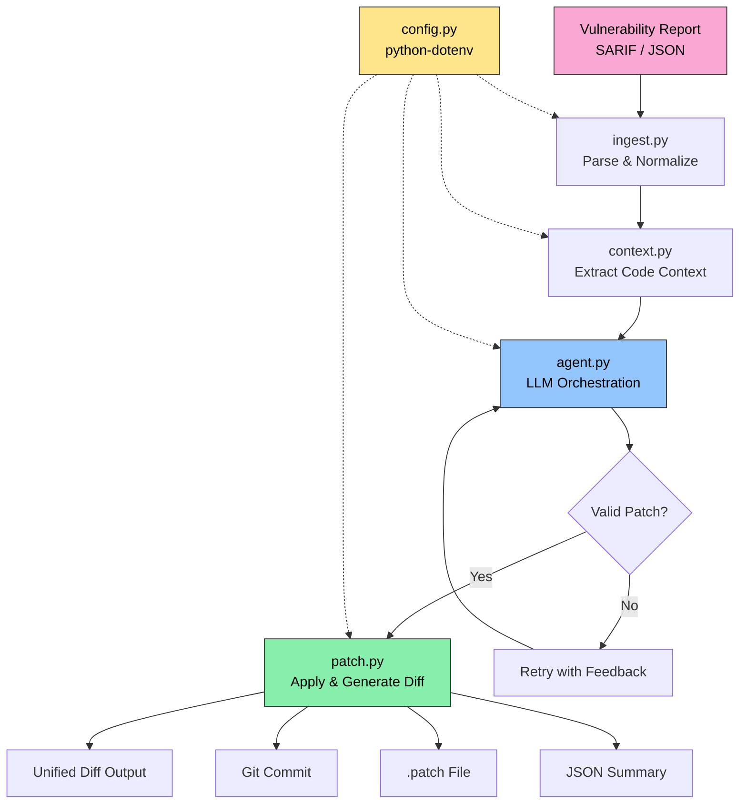

<div align="center">

# 🛡️ AutoSec-Fixer

### Autonomous AI Security Remediation Agent

**An XBOW-lite equivalent that takes vulnerability reports from static analyzers,  
autonomously analyzes the affected codebase, generates secure patches, and outputs unified diffs.**

[](https://www.python.org/downloads/)
[](LICENSE)
[](#llm-providers)
[](#supported-formats)

[Installation](#-installation) • [Usage](#-usage) • [Architecture](#-architecture) • [Configuration](#-configuration)

</div>

---

## 📋 Overview

**AutoSec-Fixer** is a fully autonomous security remediation pipeline. Feed it a vulnerability report from your favorite static analyzer, and it will:

1. **Parse** the report (SARIF, Semgrep, Bandit, or generic JSON)
2. **Extract** surrounding code context with intelligent windowing
3. **Generate** a secure patch using an LLM (OpenAI, Anthropic, or Qwen)
4. **Validate** the patch for syntax and dangerous patterns
5. **Apply** the fix, generate a unified diff, and optionally commit to Git

All API keys are loaded securely from environment variables via `python-dotenv` — **never hardcoded**.

---

## 🏗️ Architecture

### Pipeline Diagram

```
┌─────────────────────────────────────────────────────────────────────────────┐
│                          AutoSec-Fixer Pipeline                             │
├─────────────────────────────────────────────────────────────────────────────┤
│                                                                             │
│   ┌──────────────┐    ┌──────────────┐    ┌──────────────┐                 │
│   │   INGEST     │───▶│   CONTEXT    │───▶│    AGENT     │                 │
│   │  (ingest.py) │    │ (context.py) │    │  (agent.py)  │                 │
│   │              │    │              │    │              │                 │
│   │ • SARIF      │    │ • File read  │    │ • LLM prompt │                 │
│   │ • Semgrep    │    │ • ±20 lines  │    │ • Code gen   │                 │
│   │ • Bandit     │    │ • AST parse  │    │ • Validate   │                 │
│   │ • Generic    │    │ • Token mgmt │    │ • Retry loop │                 │
│   └──────────────┘    └──────────────┘    └──────┬───────┘                 │
│                                                   │                         │
│                                                   ▼                         │
│                                           ┌──────────────┐                 │
│                                           │    PATCH     │                 │
│                                           │  (patch.py)  │                 │
│                                           │              │                 │
│                                           │ • Apply fix  │                 │
│                                           │ • Gen diff   │                 │
│                                           │ • Git commit │                 │
│                                           │ • .patch out │                 │
│                                           └──────┬───────┘                 │
│                                                   │                         │
│                                                   ▼                         │
│                                     ┌─────────────────────────┐            │
│                                     │       OUTPUT            │            │
│                                     │  • Unified diffs        │            │
│                                     │  • Combined .patch file │            │
│                                     │  • Git commit           │            │
│                                     │  • JSON summary report  │            │
│                                     └─────────────────────────┘            │
│                                                                             │
│   ┌──────────────────────────────────────────────────────────────────────┐ │
│   │  config.py  ──  Loads .env via python-dotenv at import time          │ │
│   │               ──  Typed Settings dataclass, API key resolution       │ │
│   └──────────────────────────────────────────────────────────────────────┘ │
└─────────────────────────────────────────────────────────────────────────────┘
```

### Mermaid Flow Diagram



---

## ✨ Features

- **Multi-format parsing** — SARIF v2.1.0, Semgrep, Bandit, and generic JSON
- **Multi-provider LLM** — OpenAI, Anthropic, and **Qwen (DashScope)**
- **Secure by default** — API keys loaded from `.env`, never hardcoded
- **Intelligent context** — AST-based function boundary detection, token budget enforcement
- **Robust generation** — Retry logic with error feedback, JSON extraction from malformed LLM output
- **Patch validation** — Syntax checking, dangerous pattern detection, confidence thresholds
- **CWE-specific guidance** — Built-in remediation advice for 8+ CWE categories
- **Multi-strategy replacement** — Exact match → file search → fuzzy match with indentation preservation
- **Git integration** — Automatic staging, commit creation with auto-generated messages
- **Batch processing** — Multiple patches per file, applied in reverse order to avoid line shifts
- **Dry-run mode** — Preview all changes before applying anything
- **Comprehensive CLI** — Severity filtering, file glob patterns, max vuln limits

---

## 📦 Installation

### Prerequisites

- **Python 3.11+**
- An API key for at least one LLM provider:
  - [DashScope (Qwen)](https://dashscope.console.aliyun.com/) — `DASHSCOPE_API_KEY`
  - [OpenAI](https://platform.openai.com/api-keys) — `OPENAI_API_KEY`
  - [Anthropic](https://console.anthropic.com/) — `ANTHROPIC_API_KEY`
- **Git** (optional, for commit creation)

### Setup

```bash
# Clone the repository
git clone https://github.com/your-org/autosec-fixer.git
cd autosec-fixer

# Create and activate a virtual environment
python -m venv .venv
source .venv/bin/activate        # Linux / macOS
# .venv\Scripts\activate         # Windows

# Install dependencies
pip install -r requirements.txt

# Set up environment variables
cp .env.example .env
# Edit .env with your real API keys (see Configuration section below)
```

> ⚠️ **Never commit `.env` to Git.** It is excluded via `.gitignore`. Only `.env.example` (with placeholder values) is committed.

---

## 🚀 Usage

### Basic

```bash
# Process a Semgrep report (uses default provider from .env)
python main.py --report semgrep_results.json --repo /path/to/codebase

# Process a Bandit report with Anthropic Claude
python main.py --report bandit_output.json --repo ./myproject --provider anthropic

# Process a SARIF report with Qwen (DashScope)
python main.py --report findings.sarif --repo ./app --provider qwen

# Dry run — preview patches without modifying files
python main.py --report results.json --repo ./code --dry-run
```

### Advanced

```bash
# Filter by severity (only HIGH and above)
python main.py --report results.json --repo ./code --severity HIGH

# Limit to specific files via glob pattern
python main.py --report results.json --repo ./code --file-filter "src/auth/*.py"

# Process only the first 10 vulnerabilities
python main.py --report results.json --repo ./code --max-vulns 10

# Create a Git commit after patching
python main.py --report results.json --repo ./code --git-commit

# Override the model and extend context window
python main.py --report results.json --repo ./code --model qwen-max --context-lines 40

# Verbose debug logging
python main.py --report results.json --repo ./code -v
```

### CLI Reference

| Flag | Description | Default |
|------|-------------|---------|
| `--report, -r` | Path to vulnerability report (SARIF/JSON) | *required* |
| `--repo, -p` | Path to source code repository | *required* |
| `--provider` | LLM provider: `openai`, `anthropic`, `qwen` | `$AUTOFIX_DEFAULT_PROVIDER` |
| `--model` | Specific model identifier | per-provider default |
| `--api-key` | API key override (prefer `.env`) | — |
| `--severity` | Minimum severity threshold | all |
| `--max-vulns` | Maximum vulnerabilities to process | all |
| `--file-filter` | Glob pattern for file filtering | all |
| `--dry-run` | Generate patches without modifying files | `false` |
| `--output-dir` | Output directory for diffs/patches | `./autosecfix_output` |
| `--no-backup` | Skip backup file creation | `false` |
| `--git-commit` | Create Git commit after patching | `false` |
| `--context-lines` | Context lines above/below vulnerability | `20` |
| `-v, --verbose` | Enable debug logging | `false` |
| `-q, --quiet` | Suppress non-error output | `false` |

---

## 🔐 Configuration

All configuration is loaded from **environment variables** via [`python-dotenv`](https://github.com/theskumar/python-dotenv). The `config.py` module calls `load_dotenv()` at import time, so a single `from config import settings` makes everything available.

### Environment Variables

| Variable | Description | Default |
|----------|-------------|---------|
| `DASHSCOPE_API_KEY` | Qwen API key via DashScope | — |
| `OPENAI_API_KEY` | OpenAI API key | — |
| `ANTHROPIC_API_KEY` | Anthropic API key | — |
| `QWEN_API_BASE_URL` | Qwen OpenAI-compatible endpoint | `https://dashscope.aliyuncs.com/compatible-mode/v1` |
| `QWEN_MODEL_NAME` | Qwen model name | `qwen-plus` |
| `AUTOFIX_DEFAULT_PROVIDER` | Default LLM provider | `qwen` |
| `AUTOFIX_DEFAULT_MODEL` | Default model | `qwen-plus` |
| `AUTOFIX_LOG_LEVEL` | Logging level | `INFO` |
| `AUTOFIX_CONTEXT_LINES` | Context lines above/below | `20` |
| `AUTOFIX_MAX_RETRIES` | LLM generation retries | `3` |
| `AUTOFIX_TEMPERATURE` | LLM sampling temperature | `0.1` |

### How It Works

```python
# config.py (excerpt)
from dotenv import load_dotenv
from pathlib import Path
import os

# Load .env at import time
_env_file = Path(__file__).parent / ".env"
if _env_file.exists():
    load_dotenv(dotenv_path=_env_file, override=False)

# Access anywhere via the typed settings singleton
from config import settings, get_api_key, create_provider

print(settings.default_provider)   # "qwen"
provider = create_provider("qwen") # Uses DASHSCOPE_API_KEY from .env
```

### Resolution Order for API Keys

1. Explicit `--api-key` CLI argument
2. Environment variable (from `.env` or shell `export`)
3. Helpful error message with fix instructions

---

## 📁 Project Structure

```
autosec-fixer/
├── main.py              # CLI entry point & pipeline orchestration
├── config.py            # Environment loading & typed settings (python-dotenv)
├── ingest.py            # Vulnerability report parser (SARIF/JSON)
├── context.py           # Code context extraction & AST analysis
├── agent.py             # LLM orchestration & prompt engineering
├── patch.py             # Patch application & diff generation
├── requirements.txt     # Strict Python dependencies
├── .env                 # Your local API keys (NOT committed)
├── .env.example         # Template for GitHub (committed, fake values)
├── .gitignore           # Excludes .env, venv, __pycache__, etc.
├── README.md            # This file
├── tests/
│   ├── test_ingest.py
│   ├── test_context.py
│   ├── test_agent.py
│   └── test_patch.py
└── examples/
    ├── semgrep.json
    ├── bandit.json
    └── sample.sarif
```

---

## 🔧 Module Reference

### `config.py` — Configuration & Environment Loading
Loads `.env` via `python-dotenv` at import time. Provides a typed `Settings` dataclass, API key resolution with helpful error messages, and a `create_provider()` factory.

### `ingest.py` — Vulnerability Report Parser

| Format | Detection | Fields Extracted |
|--------|-----------|------------------|
| SARIF v2.1.0 | `$schema` or `runs` key | file, lines, CWE, severity, rule |
| Semgrep | `results` + `errors` keys | path, lines, CWE, severity, metadata |
| Bandit | `generated_at` + `test_id` | filename, lines, CWE, severity |
| Generic JSON | `vulnerabilities`/`findings` | file, line, severity, message |

### `context.py` — Code Context Extraction
Intelligently extracts ±20 lines (configurable) around vulnerabilities with token budget enforcement. Uses Python AST for function boundary detection. Supports 15+ languages.

### `agent.py` — LLM Orchestration Agent
Core AI agent with security-focused prompt engineering. Implements `OpenAIProvider`, `AnthropicProvider`, and `QwenProvider` via a common `LLMProvider` protocol. Includes retry logic, robust JSON parsing, and validation.

### `patch.py` — Patch Application
Multi-strategy code replacement (exact → search → fuzzy). Creates backups, generates unified diffs with vulnerability metadata, and integrates with Git for automatic commits.

---

## 🧪 Testing

```bash
# Run all tests
pytest tests/ -v

# Run with coverage
pytest tests/ --cov=. --cov-report=html

# Run specific module tests
pytest tests/test_ingest.py -v
```

---

## 🔒 Security Considerations

- **LLM Output Validation** — All generated patches pass syntax checking and dangerous-pattern detection (`exec`, `eval`, `os.system`, etc.) before application
- **Backup Files** — Original files are backed up (`.autosecfix.bak`) before modification
- **Dry Run Mode** — Always test with `--dry-run` first to review proposed changes
- **API Key Security** — Keys are loaded from `.env`, masked in logs, and never hardcoded
- **No Code Execution** — The agent does NOT execute generated code; it only generates patches
- **Confidence Thresholds** — Patches below 0.3 confidence are automatically rejected
- **Git Safety** — `.env` is excluded via `.gitignore`; only `.env.example` is committed

---

## 🤝 Contributing

1. Fork the repository
2. Create a feature branch (`git checkout -b feature/amazing-feature`)
3. Copy `.env.example` to `.env` and configure your keys
4. Write tests for new functionality
5. Ensure all tests pass (`pytest`)
6. Submit a pull request

Please open an issue for bugs, feature requests, or questions.

---

## 📄 License

This project is licensed under the **MIT License** — see the [LICENSE](LICENSE) file for details.

---

## ⚠️ Disclaimer

This tool generates code patches using AI/LLMs. **Always review generated patches before applying them to production code.** The authors are not responsible for any issues arising from the use of this tool. Security remediation should always be verified by a qualified security professional.

---

<div align="center">

**Built with 🛡️ by the AutoSec-Fixer team**

*Secure code, autonomously.*

</div>
